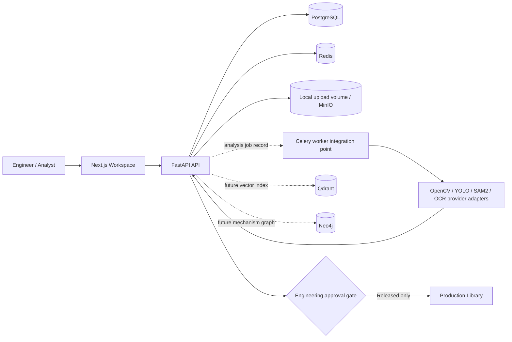

# Industrial Reverse Engineering & Digital Twin Platform

A modular engineering workspace for ingesting machine video references, organizing analysis assets, correcting component/mechanism findings, and releasing only engineer-approved digital twins.

## License and third-party materials

The MIT license applies to original code and materials created for this repository. Third-party assets, data, dependencies, and model weights retain their own licenses and notices; the repository's MIT license does not relicense them. Review upstream terms before redistributing dependencies or generated model outputs.

> **Implementation status:** this repository is a runnable foundation, not a production-ready industrial AI deployment. It includes a working FastAPI review/release API, a Next.js reviewer workspace, persistent relational records, audit events, a local development stack, and CI/deployment templates. It does **not** include trained detection/segmentation models, a video-host acquisition adapter, production identity management, or validated CAD/STEP generation. AI results must not be used for safety decisions until those integrations and engineering validation are implemented and qualified.

## Architecture



### Current implementation

- **Frontend:** Next.js App Router, React, TypeScript, Tailwind CSS, React Flow mechanism editor, and a React Three Fiber schematic viewer.
- **API:** FastAPI with SQLAlchemy models for assets, components, analysis jobs, review signatures, and audit events.
- **Persistence:** PostgreSQL in Docker Compose; SQLite is the local API default for quick development.
- **Review policy:** below 80% confidence requires Mechanical + Controls; 80–95% requires Mechanical; above 95% permits one qualified reviewer. High-risk assets require independent Mechanical + Controls signatures regardless of confidence.
- **Release gate:** an asset must be Approved, meet its signature policy, have every detected component explicitly validated, and be released by a Senior Reviewer or Administrator. `/api/library` returns Released assets only.
- **Corrections:** component edits, graph edits, and kinematic edits create a new revision. Signatures are scoped to a revision, so any correction invalidates prior approvals for release purposes.
- **Audit:** the API appends audit events for creation, submission, review, correction, signature, and release. There is intentionally no API for changing or deleting an audit record.

## Run locally

### Docker Compose (recommended)

Install Docker Desktop, then from the repository root:

```powershell
docker compose up --build
```

Open:

- Workspace: <http://localhost:3000>
- API docs: <http://localhost:8000/docs>
- API health: <http://localhost:8000/health>
- MinIO console: <http://localhost:9001>
- Qdrant dashboard: <http://localhost:6333/dashboard>
- Neo4j browser: <http://localhost:7474>

Compose credentials are for local development only. Replace them before any shared or deployed use. The API container persists uploaded videos in a named development volume.

### Backend only

```powershell
cd backend
python -m venv .venv
.\.venv\Scripts\Activate.ps1
pip install -r requirements.txt
uvicorn app.main:app --reload
```

The default `DATABASE_URL` is a local SQLite file. Set `DATABASE_URL`, `REDIS_URL`, `STORAGE_PATH`, and `CORS_ORIGINS` for another environment; see [.env.example](./.env.example).

Optional illustrative sample:

```powershell
cd backend
python -m app.seed
```

The seeded record is explicitly marked illustrative and is not an AI finding or an approved twin.

### Frontend only

```powershell
cd frontend
npm install
$env:NEXT_PUBLIC_API_URL = "http://localhost:8000"
npm run dev
```

The frontend expects the API to be reachable from the user's browser at `NEXT_PUBLIC_API_URL`.

## Example review workflow

1. Ingest a YouTube/Vimeo/direct video URL or upload an MP4/MOV/WEBM/M4V from the workspace. An Asset and queued AnalysisJob record are created.
2. Visit `/engineering-review`, open the asset, and submit it for review if it is still Draft.
3. Inspect the schematic twin preview, correct/validate components, edit mechanism nodes/edges, and revise kinematic JSON. Every edit creates an audit event and a new revision.
4. Record the required independent review decisions. The policy is computed from asset confidence and the high-risk flag.
5. Release only after the API confirms the approval policy and every component is explicitly approved. The released record appears in the production library.

The URL intake currently stores a source reference; it does not download media from a third-party host. Upload intake stores the video locally. No CV inference is claimed: job records expose their queued state and explicitly report that a provider/worker must be configured.

## API outline

| Method | Path | Purpose |
|---|---|---|
| `POST` | `/api/assets` | Register a supported video URL and create a queued analysis job |
| `POST` | `/api/assets/upload` | Store an uploaded video and create a queued analysis job |
| `GET` | `/api/assets` | List assets; optional `status` and `discipline` filters |
| `GET` | `/api/review/queue` | List pending engineering reviews |
| `GET` | `/api/assets/{id}` | Read asset, components, and jobs |
| `GET` | `/api/assets/{id}/media` | Stream the uploaded source video |
| `POST` | `/api/assets/{id}/submit` | Submit a draft/rejected record for review |
| `POST/PATCH/DELETE` | `/api/assets/{id}/components...` | Add, correct, validate, or remove a component |
| `PUT` | `/api/assets/{id}/mechanism` | Validate and replace the mechanism graph |
| `PUT` | `/api/assets/{id}/kinematics` | Validate joint types and replace kinematic data |
| `POST` | `/api/assets/{id}/decision` | Approve, approve with changes, or reject |
| `POST` | `/api/assets/{id}/signatures` | Add an independent validation signature |
| `POST` | `/api/assets/{id}/release` | Release an approved, fully validated asset |
| `GET` | `/api/assets/{id}/audit` | Read append-only audit history |
| `GET` | `/api/jobs/{id}` | Inspect analysis job status |
| `GET` | `/api/library` | List Released assets only |

Interactive request/response definitions are available at `/docs`.

## Data model

- `assets`: source reference, review status, confidence, discipline/risk flags, engineering description, graph/kinematic JSON, and revision number.
- `components`: classification, confidence, bounding box, relationships, and explicit engineer approval.
- `analysis_jobs`: queue state, pipeline stage, errors, and completion time.
- `review_signatures`: reviewer identity string, engineering role, comment, timestamp, and the asset revision approved.
- `audit_events`: actor, role, action, comment, revision, JSON snapshot, and timestamp.

For production, replace startup `create_all()` with versioned database migrations and enforce audit immutability with database permissions/WORM storage and independent backups.

## Integration roadmap / deployment requirements

The supplied Compose file provisions PostgreSQL, Redis, MinIO, Qdrant, and Neo4j. Only PostgreSQL and the local media volume are currently connected to application paths; the other services are infrastructure integration points, not yet populated by API code.

Before production use:

1. Implement authenticated users and server-enforced RBAC (current reviewer identity/role are request fields and are **not authentication**).
2. Add a Celery worker, retry/idempotency policy, media acquisition adapter with host allowlists, and durable object-storage integration.
3. Implement and qualify OpenCV frame/scene extraction, model-backed YOLO/SAM2 detection, OCR, and vision-language reporting. Preserve raw output and model/version provenance.
4. Add signed migrations, rate limits, upload malware scanning, retention/consent policy, encryption/key management, secret rotation, audit archival, monitoring, and backups.
5. Implement Qdrant embeddings, Neo4j relationships, SVG/DXF/PDF generation, and verified GLTF/GLB/STEP geometry pipelines.
6. Add domain-specific safety-review rules, independent identity checks, signature cryptography, and integration/end-to-end tests for every release-policy combination.
7. Replace example Kubernetes images/domains, configure registry and external managed services, use Kubernetes Secrets/external secret manager, and configure TLS, ingress, security context, autoscaling, storage classes, PDBs, and network policies.

`k8s/` is a deployment template, not a turnkey production cluster: it deliberately contains example image references and placeholder secret values.

## Development checks

```powershell
cd backend
pytest
```

```powershell
cd frontend
npm run build
```

CI runs the backend tests and frontend production build on pull requests and pushes to `main`.
